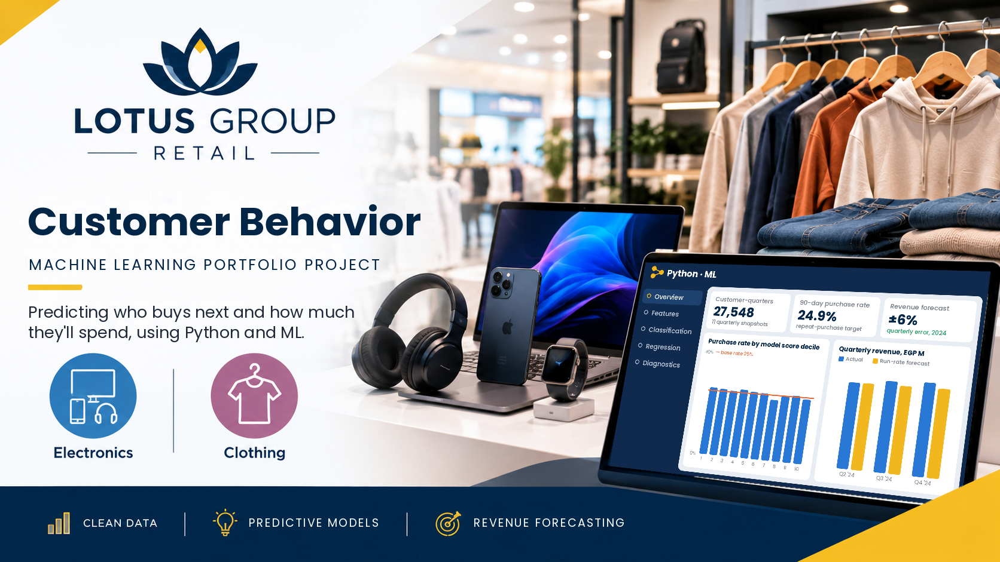
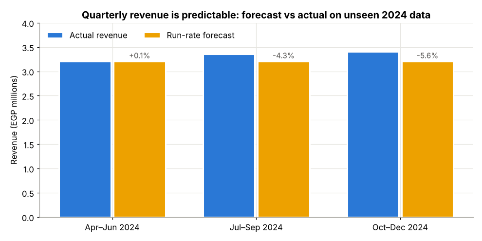
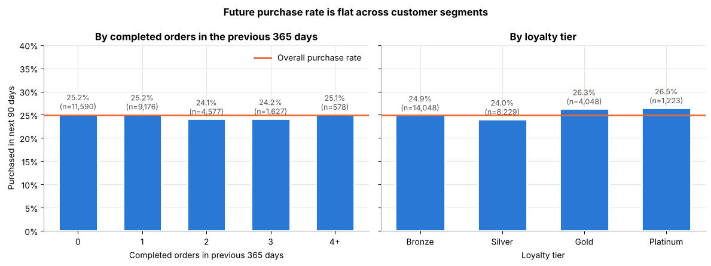
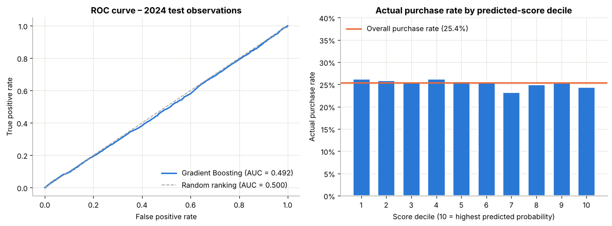

<h1 align="center">Lotus Group Customer Behavior Analysis</h1>

<p align="center">

</p>

<p align="center">
<b>Can a retailer predict which customers will buy next, and how much they'll spend? This project built a leakage-proof machine-learning pipeline to find out. It showed that targeting customers by purchase history would do no better than picking them at random, and it produced a quarterly revenue forecast accurate to within 6%.</b>
</p>

<p align="center">
<code>Python</code> · <code>pandas</code> · <code>scikit-learn</code> · <code>Feature engineering</code> · <code>Time-based validation</code> · <code>Classification & regression</code> · <code>Model diagnostics</code>
</p>

---

## At a glance

| | |
|---|---|
| **Business question** | Which customers will buy in the next 90 days, and how much will they spend? |
| **Data** | 9 linked tables · 3,000 customers · 12,000 orders · 15 stores · Jan 2022 – Dec 2024 |
| **Modelling dataset** | 27,548 customer-quarter snapshots with 20 features, all built without using future information |
| **Models** | 3 classifiers and 3 regressors, each compared against simple baselines on unseen 2024 data |
| **Headline result** | Customer-level prediction performs at chance (ROC-AUC 0.49), but **quarterly revenue is forecast to within 0.1–5.6%** |
| **Business value** | Avoids spending on a targeting model that can't work, and gives finance a revenue forecast it can rely on |

> **Why this project is different:** a model can show a high score and still fail once it's live. This project tested whether the model was actually learning anything, and when it wasn't, worked out why. The same checks protect any client from investing in a model that only looks good on paper.

---

## 1. The problem

> *"Client runs 15 stores across Egypt and has three years of customer, order and returns data. They'd like to know which customers are likely to buy again in the next three months and how much they'll spend, so client can focus our retention budget and plan revenue. But the question is: Can the data actually tell the client that?"*

This is a follow-on to the [Lotus Group Retail Analytics](https://github.com/Vin-Okumu/lotus-group-retail-analytics) Power BI project. That project explained **what happened**. This one asks **what would happen nex?**.

---

## 2. The data

| | |
|---|---|
| **Source** | Lotus Group operational exports (a fictional, educational dataset; see the [disclaimer](#data-disclaimer)) |
| **Size** | 9 raw CSV tables: 3,000 customers · 12,000 orders · 25,099 order lines · 345 products · 1,056 returns |
| **Time range** | 1 Jan 2022 – 31 Dec 2024 (3 full years) |
| **Revenue covered** | EGP 45.4M in orders, of which EGP 39.7M came from completed orders |

The data had real-world problems, and each one was found, documented and handled:

- **50 duplicate customer records** were removed.
- **567 invalid birth dates** were set to missing rather than guessed.
- **Cancelled orders still showed EGP 1.7M in revenue**, so a clear rule was set: only *completed* orders count as purchases.
- **17% of orders were dated before the customer had registered.** These were excluded consistently from both features and targets.

Every decision is recorded in the [data quality log](02_Docs/data_quality_log.md) and the [data inventory log](02_Docs/data_inventory_log.md).

---

## 3. Approach

```
Data inventory → Quality audit → Cleaning → Exploratory analysis → Feature engineering → Time-based modelling → Diagnostics → Recommendations
```

1. **Audit and clean** the nine tables: keys, duplicates, data types, dates and order-status rules. → [`data inventory`](03_Notebooks/01_data_inventory.ipynb) · [`dat cleaning`](03_Notebooks/02_data_cleaning.ipynb)
2. **Explore customer behaviour**: purchase frequency, spending, product preferences, seasonality and returns. → [`EDA`](03_Notebooks/03_exploratory_data_analysis.ipynb)
3. **Build customer snapshots without leakage.** Customers were captured at 11 quarter-end dates. Each snapshot's features (RFM, recent 90/180/365-day activity, returns and cancellations, tenure, age, loyalty tier, city) use **only data available on that date**. The targets come from the following 90 days. → [`ML`](03_Notebooks/04_machine_learning.ipynb)
4. **Validate the way the model would actually be used**: train on 2022–2023, choose models and thresholds on late 2023, then test **once** on 2024.
5. **Benchmark every model against simple rules**: "nobody buys", "contact whoever bought most recently", "predict the average" and "predict zero".
6. **Model**: Logistic Regression, Random Forest and Gradient Boosting for *will they buy?*; Ridge, Random Forest and Gradient Boosting for *how much?*
7. **Diagnose the results** with a permutation test, a variance check and a planted-signal test, to prove whether the result came from the data or from the code.

**Tools:** Python · pandas · NumPy · scikit-learn · Matplotlib · Jupyter · Git/GitHub

---

## 4. Results

### Finding 1: Quarterly revenue is highly predictable

A simple *active customers × average spend per customer* forecast, built only on 2022–2023 data, predicted 2024 quarterly revenue to within **0.1%, 4.3% and 5.6%**. For budgeting and stock planning, this is the number that matters.

<p align="center">

</p>

### Finding 2: Purchase history does not predict *which* customers will buy

About **25% of customers buy in any 90-day window**, and that rate is the same in every segment. Customers with 4+ orders last year buy at the same rate as those with none. Platinum members buy at the same rate as Bronze.

<p align="center">

</p>

### Finding 3: No model beat the simple baselines, and the diagnostics show why

| Task | Best model | Result on unseen 2024 data | What it means |
|---|---|---|---|
| Will the customer buy in the next 90 days? | Gradient Boosting | ROC-AUC **0.49**, top-10% lift **0.96×** | Same as random selection (0.50 / 1.0×) |
| Business rule: target recent buyers | Recency rule | ROC-AUC **0.50**, top-10% lift **1.06×** | Same as random selection |
| How much will the customer spend? | Gradient Boosting | R² **≈ 0**; MAE EGP 1,795 vs EGP 1,107 for "predict zero" | Learns the average, nothing more |

<p align="center">

</p>

Three diagnostic tests confirmed that this is a property of the data, not a bug:

- **Permutation test:** the model trained on real labels scored no better than models trained on shuffled labels (p = 0.74).
- **Variance check:** purchase counts per customer have a variance-to-mean ratio of 0.95, which is what you'd expect if every customer had the same purchase rate. Each customer's order count in one year has almost no correlation with the next year's (about 0.01 and −0.04).
- **Planted-signal test:** when a realistic link between recency and purchasing was planted in the data, the same pipeline found it straight away (ROC-AUC **0.76**, top-10% lift **2.6×**). The pipeline works; the data simply has nothing at customer level to find.

---

## 5. Recommendations

1. **Plan revenue at portfolio level.** Use *active customers × average spend per customer* as the quarterly baseline, and add a buffer for the handful of very large electronics orders that cause most of the forecast error.
2. **Don't buy or build a history-based targeting model on this data.** It would rank customers no better than chance. Spend the retention budget on broad, base-wide campaigns, and run **randomised A/B tests** to measure what actually changes behaviour.
3. **Review the loyalty programme.** Higher tiers don't purchase more often, so the tier benefits aren't driving repeat visits. Test tier perks against a control group before investing further.
4. **Collect the data that does predict behaviour.** Campaign exposure and responses, website or app visits, basket contents over time, and service or complaint history are the signals that make customer-level models work.
5. **Fix registration data at the source.** One in six orders is dated before the customer registered. A system check at sign-up would remove this inconsistency.

---

## 6. Limitations

- **Fictional dataset.** The diagnostics show that orders behave as if they were assigned to customers at random. Real retail customers differ from each other, so on real data this same pipeline would be expected to find usable signal, as the planted-signal test shows.
- **One prediction window.** Only a 90-day horizon was modelled.
- **Repeated customers across snapshots.** The time-based split protects the 2024 test results, but uncertainty in the metrics is somewhat understated.

---

## 7. How to run

**Requirements:** Python 3.10+ and Jupyter

```bash
git clone https://github.com/Vin-Okumu/lotus-group-customer-behavior-analysis.git
cd lotus-group-customer-behavior-analysis
pip install pandas numpy scikit-learn matplotlib jupyter
jupyter notebook
```

Open the notebooks in `03_Notebooks/` and run them in order (`01` → `04`). Notebook `04_machine_learning.ipynb` reads the cleaned files in `01_Data/processed/`, so it can also be run on its own.

### Repository structure

```
lotus-group-customer-behavior-analysis/
├── 01_Data/
│   ├── raw/                  # 9 source CSV tables
│   └── processed/            # Cleaned tables produced by notebook 02
├── 02_Docs/                  # Project charter, data inventory and data quality logs
├── 03_Notebooks/
│   ├── 01_data_inventory.ipynb
│   ├── 02_data_cleaning.ipynb
│   ├── 03_exploratory_data_analysis.ipynb
│   └── 04_machine_learning.ipynb
├── 04_Src/                   # Reserved for reusable code
├── 05_Images/                # Cover and README charts
└── README.md
```

---

### Data disclaimer

This project uses a **fictional, educational dataset**. The company, customers and transactions are not real and do not represent any actual business. Figures are in Egyptian pounds (EGP).

---

I can do the same for your business: *audit your data, build predictive models you can trust, and tell you plainly what your data can and can't answer before you invest in it.*

Invite to work on [Upwork](https://www.upwork.com/freelancers/uv23o9) · Reach out on [LinkedIn](https://www.linkedin.com/in/vince-okumu23/) · Or send me an email at vinny.otieno23@gmail.com

**Vincent Okumu** · Data Analyst · Python & Machine Learning

*Open to freelance Python, machine learning and retail analytics work.*
