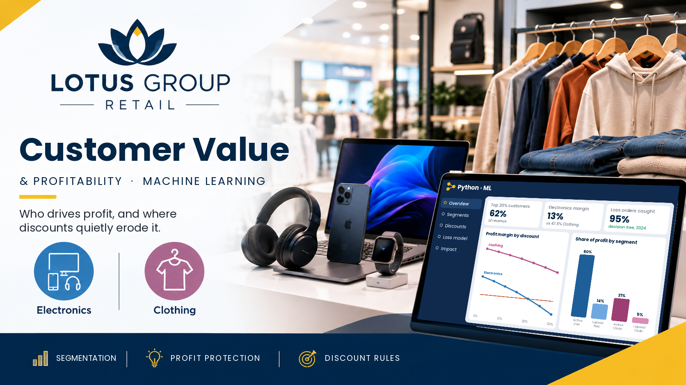
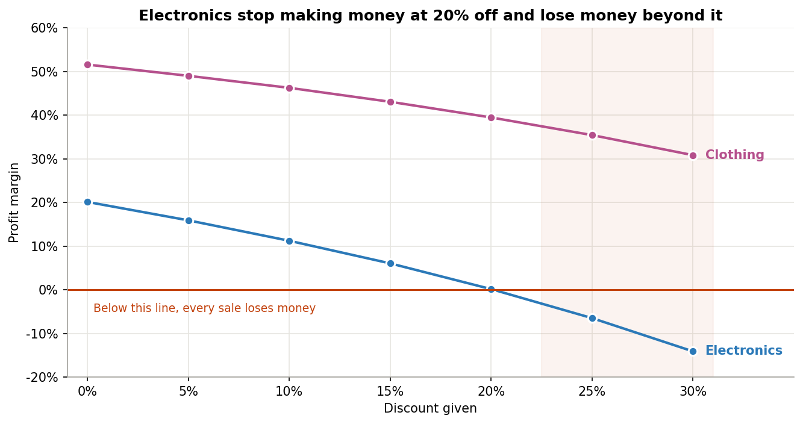
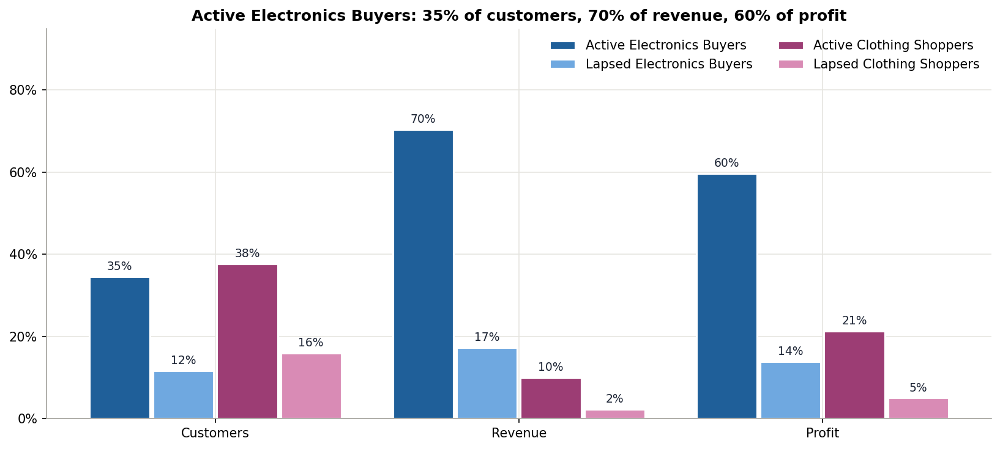
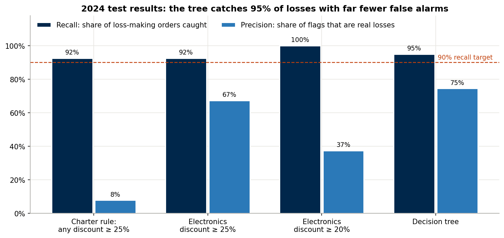
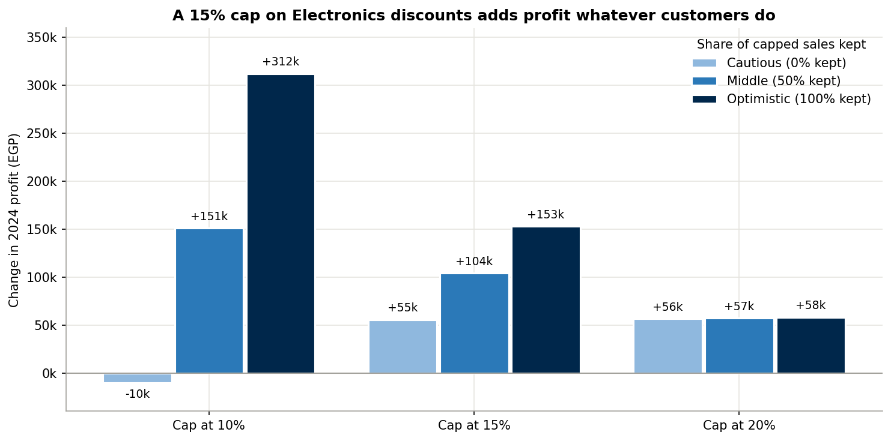

<h1 align="center">Lotus Group Customer Value & Profitability Analysis</h1>

<p align="center">

</p>

<p align="center">
<b>Who really drives a retailer's profit, and where do discounts quietly destroy it? Machine learning on three years of sales from a 15-store chain revealed four customer segments, showed that a fifth of customers bring in 62% of revenue, and produced checkout rules that catch 95% of loss-making orders. A simple discount cap would have added up to EGP 153,000 of profit in 2024 alone.</b>
</p>

<p align="center">
<code>Python</code> · <code>pandas</code> · <code>scikit-learn</code> · <code>K-Means clustering</code> · <code>Decision trees</code> · <code>Feature engineering</code> · <code>Scenario analysis</code>
</p>

---

## At a glance

| | |
|---|---|
| **Business question** | Which customers drive our profit, and which discounts are costing us money? |
| **Data** | 9 linked tables · 3,000 customers · 12,000 orders · 15 stores · Jan 2022 – Dec 2024 |
| **Machine learning** | K-Means segmentation of 2,908 customers · decision tree that flags loss-making orders at checkout |
| **Headline results** | 4 customer segments (silhouette 0.46) · 95% of loss-making orders caught on unseen 2024 data |
| **Business value** | A 15% cap on Electronics discounts adds **EGP 55k–153k a year in every scenario**; all actions together could add **5–19% to annual profit** |

---

## 1. The problem

> *"We've grown to 15 stores and EGP 40M in completed sales, but we don't know which customers really drive our business or whether our discounts are paying off. We need to know who to prioritise, and which discounts we should stop."*

This project follows on from the [Lotus Group Retail Analytics](https://github.com/Vin-Okumu/lotus-group-retail-analytics) Power BI dashboard. That project showed **how much** the business sold. This one explains **who** and **what** makes those sales profitable, and **where** profit is lost.

---

## 2. The data

| | |
|---|---|
| **Source** | Lotus Group operational exports (a fictional, educational dataset; see the [disclaimer](#data-disclaimer)) |
| **Size** | 9 raw CSV tables: 3,000 customers · 12,000 orders · 25,099 order lines · 345 products · 1,056 returns · 15 stores |
| **Time range** | 1 Jan 2022 – 31 Dec 2024 (3 full years) |
| **After cleaning** | 10,529 qualifying sales · **EGP 40.1M revenue · EGP 8.5M gross profit** (21.3% margin) |

The data was audited before any number was trusted:

- **50 duplicate customers** were removed, and **567 invalid birth dates** were set to missing rather than guessed.
- Revenue and cost were **reconciled across order lines, orders and the product table**, with zero mismatches.
- Clear sales rules were set: **cancelled orders** (EGP 1.68M of booked value) and **refunded or pending returns** are excluded, and **rejected returns** count as sales.
- **17% of order value** came from orders dated before the customer registered. These are kept as valid sales, and customer tenure is measured from the first purchase instead.

Every decision is recorded in the [data quality log](02_Docs/data_quality_log.md). The objectives and success criteria were fixed in the [project charter](02_Docs/project_charter.md) **before** any modelling.

---

## 3. Approach

```
Audit → Clean → Explore → Engineer features → Segment customers → Detect loss-making orders → Estimate business impact
```

| Step | What was done | Notebook |
|---|---|---|
| Audit and clean | Integrity checks, business rules for sales, one trusted sales table with profit | [`01`](03_Notebooks/01_data_inventory.ipynb) · [`02`](03_Notebooks/02_data_cleaning.ipynb) |
| Explore | Revenue concentration, category margins, the effect of discounts, store performance | [`03`](03_Notebooks/03_exploratory_data_analysis.ipynb) |
| Engineer features | A customer table (value, engagement, product mix, discount use) and an order table (only what is known at checkout) | [`04`](03_Notebooks/04_feature_engineering.ipynb) |
| **ML part A: segmentation** | K-Means on spend, Electronics share and recency; three feature sets compared; number of segments chosen on statistics *and* business value; stability tested on resampled data | [`05`](03_Notebooks/05_customer_segmentation.ipynb) |
| **ML part B: loss detection** | Depth-3 decision tree; trained on 2022–2023, tuned on 2023, tested once on 2024; compared with simple rules and gradient boosting; turned into plain checkout rules | [`06`](03_Notebooks/06_loss_making_orders.ipynb) |
| Business impact | Discount-cap scenarios, approval-check savings, campaign sizing, recommendations | [`07`](03_Notebooks/07_business_impact.ipynb) |

**Tools:** Python · pandas · NumPy · scikit-learn · Matplotlib · Jupyter · Git/GitHub

**Non-technical summary:** a 6-slide deck is in [`04_Output`](04_Output/Lotus_Group_Customer_Value_Profitability.pptx).

---

## 4. Results

### Finding 1: A fifth of customers bring in most of the value

The **top 20% of customers bring in 62% of revenue and 48% of profit**, and every one of them buys Electronics. Profit is less concentrated than revenue because the biggest spenders buy the lowest-margin products.

### Finding 2: Electronics bring in the revenue; Clothing makes the profit

Electronics make up **76% of revenue but only 46% of profit**, with a margin of 13% against 47.5% for Clothing. Because Electronics start with so little margin, **they break even at 20% off and lose money at 25–30% off**, while Clothing stays profitable even at 30% off.

<p align="center">

</p>

### Finding 3: Four customer segments, each with a clear action

K-Means clustering met every success criterion set in advance: **silhouette 0.46** (target ≥ 0.30), smallest segment **12%** (target ≥ 5%), and **stable** across random seeds and resampled data (agreement score ≥ 0.97).

<p align="center">

</p>

| Segment | Customers | Revenue | Profit | Action |
|---|---:|---:|---:|---|
| **Active Electronics Buyers** | 35% | **70%** | **60%** | Protect with service and bundles, not deeper discounts |
| **Lapsed Electronics Buyers** | 12% | 17% | 14% | Win back: 340 customers who spent EGP 6.9M |
| **Active Clothing Shoppers** | 38% | 10% | **21%** | Grow: the highest margin (~47%) |
| **Lapsed Clothing Shoppers** | 16% | 2% | 5% | Reactivate cheaply (email or SMS) |

Surprise: **loyalty tiers bear no relation to value.** Platinum members spend and earn no more than Bronze members.

### Finding 4: A three-rule decision tree catches 95% of loss-making orders

On **2024 orders the model had never seen**, the decision tree caught **38 of 40 loss-making orders (95%)**, which is **98.7% of the money lost**. About 3 in 4 of the orders it flagged really lost money, and it flags only about one order a week across the whole chain.

<p align="center">

</p>

| Approach (2024 test data) | Recall | Precision | F1 |
|---|---:|---:|---:|
| Rule: any discount ≥ 25% | 92.5% | 7.8% | 0.15 |
| Rule: Electronics discount ≥ 25% | 92.5% | 67.3% | 0.78 |
| Rule: Electronics discount ≥ 20% | 100% | 37.4% | 0.54 |
| **Decision tree (depth 3)** | **95.0%** | **74.5%** | **0.84** |

In plain language: **ask for manager approval when an Electronics item is discounted 25% or more and the basket's overall discount stays above about 22%, or when an all-Electronics basket has at least EGP 9,500 sold at 20% off.**

---

## 5. Recommendations

<p align="center">

</p>

| # | Recommendation | Estimated value (2024 basis) |
|---|---|---|
| 1 | **Cap Electronics discounts at 15%**, with manager approval above that. It adds profit even if every affected customer walks away. | **+EGP 55k – 153k a year** |
| 2 | **Use the decision-tree rules as an approval check** for any exception to the cap. | Protects ~EGP 40k a year (overlaps with #1) |
| 3 | **Protect Active Electronics Buyers** with service, warranties and bundles, not deeper discounts. | Safeguards 60% of profit |
| 4 | **Win back Lapsed Electronics Buyers**, with offers within the 15% cap. | +EGP 35k – 141k a year at a 5–20% win-back rate |
| 5 | **Grow Active Clothing Shoppers** with cross-selling and repeat-visit rewards. | +EGP 51k – 254k a year at a 10–50% response |
| 6 | **Re-base loyalty tiers on customer value**, so the best perks go to the most profitable customers. | Better-targeted perks |
| 7 | **Pilot the cap in a few stores first** to measure how customers respond before a chain-wide rollout. | Reduces rollout risk |

**Combined, these actions could add EGP 140k – 550k a year: 5–19% of 2024 profit.** The discount cap is the most certain part, because it relies only on transactions already observed.

### Limitations

- **Customer response is uncertain.** The cap's effect is shown as a range, and campaign figures (#4–5) are illustrative assumptions that should be tested with A/B experiments.
- **Small number of loss-making orders.** The 2024 test set contains 40, so each one moves recall by 2.5 points. Results were consistent across the 2023 validation year and the 2024 test year.
- **Segments describe past behaviour.** They guide prioritisation and are not forecasts of what each customer will do next.
- **Fictional dataset.** The figures demonstrate the method and its business use, not results for a real retailer.

---

## 6. How to run

**Requirements:** Python 3.10+

```bash
git clone https://github.com/Vin-Okumu/lotus-group-customer-value-and-profitability.git
cd lotus-group-customer-behavior-analysis
pip install -r requirements.txt
jupyter notebook
```

Run the notebooks in `03_Notebooks/` **in order, `01` → `07`**. Starting from the raw files, every notebook creates and saves the data it passes on, so the whole project rebuilds from scratch:

| Notebook | Reads | Creates |
|---|---|---|
| `02_data_cleaning` | `01_Data/raw/` | `01_Data/processed/` (including `sales_clean.csv`) |
| `03_exploratory_data_analysis` | `processed/` | README charts in `05_Images/` |
| `04_feature_engineering` | `processed/` | `01_Data/features/customer_features.csv`, `order_features.csv` |
| `05_customer_segmentation` | `features/` | `01_Data/outputs/customer_segments.csv`, segment chart |
| `06_loss_making_orders` | `features/` | `06_Models/loss_order_tree.joblib`, `outputs/order_risk_flags_2024.csv`, model charts |
| `07_business_impact` | `processed/`, `outputs/` | scenario and impact charts |

### Repository structure

```
lotus-group-customer-value-&-profitability-analysis/
├── 01_Data/
│   ├── raw/              # 9 source CSV tables
│   ├── processed/        # Cleaned tables, created by notebook 02
│   ├── features/         # Modelling tables, created by notebook 04
│   └── outputs/          # Segments and order risk flags, created by notebooks 05–06
├── 02_Docs/              # Project charter, data inventory and data quality logs
├── 03_Notebooks/
│   ├── 01_data_inventory.ipynb
│   ├── 02_data_cleaning.ipynb
│   ├── 03_exploratory_data_analysis.ipynb
│   ├── 04_feature_engineering.ipynb
│   ├── 05_customer_segmentation.ipynb
│   ├── 06_loss_making_orders.ipynb
│   └── 07_business_impact.ipynb
├── 04_Output/            # Slide deck summarising the project for non-technical audiences
├── 05_Images/            # Cover and charts used in this README
├── 06_Models/            # Saved decision tree, created by notebook 06
├── requirements.txt
└── README.md
```

---

### Data disclaimer

This project uses a **fictional, educational dataset**. The company, customers and transactions are not real and do not represent any actual business. Figures are in Egyptian pounds (EGP).

---

I can do the same for your business: *find out which customers and products really make you money, spot where discounts or pricing are eroding your margins, and turn the findings into clear rules your team can act on.*

Invite to work on [Upwork](https://www.upwork.com/freelancers/uv23o9) · Reach out on [LinkedIn](https://www.linkedin.com/in/vince-okumu23/) · Or send me an email at vinny.otieno23@gmail.com

**Vincent Okumu** · Data Analyst · Python & Machine Learning

*Open to freelance Python, machine learning and retail analytics work.*
